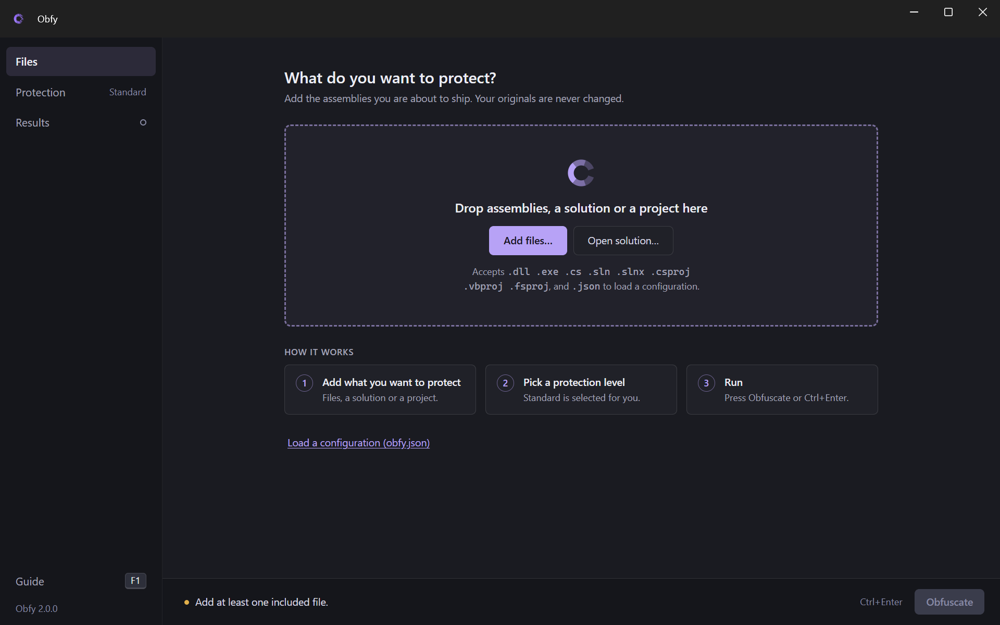
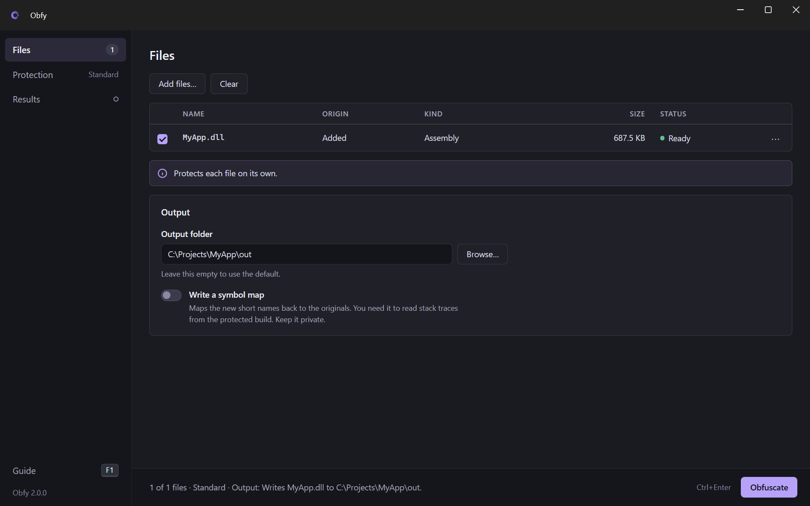
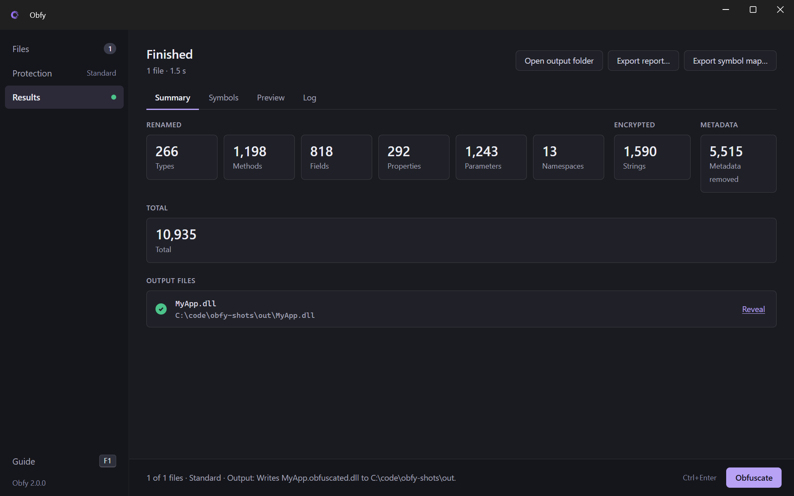

#  Obfy

[](https://www.nuget.org/packages/Obfy/) [](https://www.nuget.org/packages/Obfy/) [](LICENSE) [](https://dotnet.microsoft.com/) [](https://github.com/mortenbrudvik/Obfy/actions/workflows/ci.yml)

<a href="https://apps.microsoft.com/detail/9NNLPK835QM4">
  <picture>
    <source media="(prefers-color-scheme: dark)" srcset="https://get.microsoft.com/images/en-us%20light.svg">
    
  </picture>
</a>

**Professional .NET obfuscation tool for protecting C# assemblies and source code.**

Obfy helps protect your .NET applications from reverse engineering by applying multiple obfuscation techniques including string encryption, control flow obfuscation, symbol renaming, anti-debugging, anti-tamper, and metadata removal.

These techniques raise the cost of casual reverse engineering. They are **not** confidentiality: decryption keys live in the output assembly. Do not ship real secrets (API keys, tokens, credentials) inside an assembly and rely on obfuscation.



*The Files screen on first launch. The desktop app is a WebView2 + React UI, described under [Desktop Application](#desktop-application).*

## Why Obfy?

- **Easy to Use** - Single command to obfuscate your assemblies
- **Configurable** - From minimal to aggressive protection levels, plus an interactive `config wizard`
- **Modern** - Built for .NET 10; CLI runs cross-platform, the desktop UI is Windows
- **Extensible** - JSON configuration for fine-grained control
- **IDE Integration** - A Visual Studio 2022 extension with right-click obfuscation
- **Fast** - Efficient obfuscation with minimal overhead

## Installation

### Windows installer / MSIX

<a href="https://apps.microsoft.com/detail/9NNLPK835QM4">
  <picture>
    <source media="(prefers-color-scheme: dark)" srcset="https://get.microsoft.com/images/en-us%20light.svg">
    
  </picture>
</a>

Free download for Windows. The Store package installs the desktop app and adds the `obfy` command to your PATH.

Direct download (no Store): [ObfySetup-1.3.0.exe](https://github.com/mortenbrudvik/Obfy/releases/latest) from GitHub Releases.

You can also build a sideload/Store MSIX locally:

```powershell
.\build\build-msix.ps1
```

See `package/README.md` for sideload, certificate trust, and Partner Center identity steps. Privacy policy: [PRIVACY.md](PRIVACY.md).

### .NET tool (CLI, CI, Linux/macOS)

Requires the .NET 10 SDK or runtime.

```bash
dotnet tool install --global Obfy
```

Per-repo (commit `.config/dotnet-tools.json` so CI can `dotnet tool restore`):

```bash
dotnet new tool-manifest
dotnet tool install Obfy
```

If both the Windows installer/MSIX and the global tool are installed, both register the `obfy` command. Use one or the other on PATH.

## Quick Start

### Command Line

```bash
# Basic obfuscation with standard protection
obfy MyApp.dll -o output/

# Obfuscate a solution as a closed set
obfy MyApp.sln -o out/

# Aggressive protection (stronger; test thoroughly)
obfy MyApp.dll -l aggressive -o output/

# Using a configuration file
obfy MyApp.dll -c obfy.json -o output/

# Generate a configuration file
obfy config generate -o obfy.json

# Generate an obfuscation report
obfy MyApp.dll -o output/ --report report.html

# Interactive configuration wizard
obfy config wizard -o obfy.json
```

### Desktop Application

Obfy also includes a Windows desktop application: a native WPF window that hosts a React interface in WebView2. It needs the [Microsoft Edge WebView2 Runtime](https://developer.microsoft.com/microsoft-edge/webview2/) (the installer includes it; it is already present on current Windows 10/11). Building it from source also needs [Node.js](https://nodejs.org/) 24.

```bash
# Run from a Release build (builds the web UI with npm, then starts the app)
dotnet run --project Src/Obfy.UI/Obfy.UI.csproj -c Release

# Open with files already loaded
dotnet run --project Src/Obfy.UI/Obfy.UI.csproj -c Release -- MyApp.dll -o output/

# Development with hot reload (Vite dev server + the app; PowerShell 7)
.\scripts\dev.ps1
```

The window has a sidebar with four screens: **Files** (drop or add inputs, choose the output folder and symbol map), **Protection** (level presets and a detail view for every technique), **Results** (summary, symbol map, decompiled preview, and the run log), and **Guide** (F1: a short quick-start with a button that opens the [full guide online](https://brudvik.com/obfy/guide) in your browser). A run bar along the bottom starts or cancels a run and says why it cannot start when it cannot.



*The Files screen with one assembly added, an output folder chosen, and the run bar showing what Obfuscate will do.*

**Features:**
- Drag and drop assemblies, source files, a solution or project, or a `.json` configuration onto the window. A solution or project expands into included outputs and skipped rows
- Closed-set protection when two or more *included* assemblies are listed, or when files came from a solution/project session (the Merge toggle still wins)
- An empty Output Directory writes one file next to the input as `*.obfuscated.*`, two or more C# files compiled together to an `obfy-src` folder next to the first, a closed set to an `obfy-out` folder next to the first included assembly, and a merge next to the first input as `*.obfuscated.*`.. With an Output Directory set, each file keeps its name there. (The command line differs: a merge without `-o` is `{name}.merged{ext}`, and a solution's `obfy-out` goes next to the solution file. See the [CLI Reference](docs/CLI.md))
- Level presets (Minimal, Standard, Aggressive, Custom). Choosing Custom again restores the switches from before the preset
- Runtime profiles disable protections that profile cannot use and keep the stored values
- An in-app quick-start Guide (F1) with a button to the full guide online ([brudvik.com/obfy/guide](https://brudvik.com/obfy/guide), opened in your browser), and a description and options for every technique on the Protection screen, each with a **Read more online** link to its section of the online guide
- A path passed with `-o` applies to that session and is not saved as the default. A saved folder that no longer exists is cleared, with a warning
- Indeterminate progress for one file, a merge, and a closed set. The log keeps earlier runs. Obfuscate stays disabled, with the reason shown, until the settings and inputs allow a run
- Results group symbols under their types, hide zero counters, and export the symbol map. Preview decompiles only after you pick a file



*The Results screen after a run, on the Summary tab. Symbols, Preview and Log are the other tabs.*

### Visual Studio Extension

For Visual Studio 2022 users, Obfy provides IDE integration from source (not on Marketplace or GitHub Releases yet):

```bash
dotnet build Src/Obfy.VisualStudio/Obfy.VisualStudio.csproj -c Release
```

Then in Visual Studio: Extensions → Manage Extensions → Install from VSIX, and pick the `.vsix` under `Src/Obfy.VisualStudio/bin/Release/`.

**Features:**
- Right-click project → **Obfuscate** to protect your output assembly
- **Enable / Disable Post-Build Obfuscation** for automatic protection on each build
- **Obfy Settings** dialog with level presets (Minimal/Standard/Aggressive/Custom)
- Per-project configuration stored in `obfy.json`
- Output window integration for real-time progress
- Tools → Options → Obfy for global defaults, including **Generate Symbol Map** (off by default; writes `{name}.map.json` beside the assembly)

### Visual Studio Code (stub)

`Src/Obfy.VSCode` contributes JSON schema validation for `obfy.json` and a problem matcher for CLI `Error:` / `⚠` lines. There is no TaskProvider; add a shell task that runs `obfy` on PATH. See `Src/Obfy.VSCode/README.md`.

## Before & After

**Original code:**
```csharp
public class UserService
{
    public User GetUser(int userId)
    {
        var status = "Looking up user";
        return Database.Query(status, userId);
    }
}
```

**After obfuscation (conceptual):**
```csharp
public class _‌‍‏‎
{
    public _‌‍‎ _‌‍‏‪(int _‌‍‏‫)
    {
        var _‌‍‏‬ = _StringDecryptor.Decrypt(encodedIndex);
        return _‌‍‎‏._‌‍‏‭(_‌‍‏‬, _‌‍‏‫);
    }
}
```

String/constant “encryption” is obfuscation. The key is in the assembly and is recoverable.

## Protection Levels

| Level | Description | Use Case |
|-------|-------------|----------|
| `minimal` | Symbol renaming and debug information removal | Quick protection, debugging easier |
| `standard` | String encryption + renaming + metadata | Balanced protection (default) |
| `aggressive` | Most protections on (control-flow intensity 80; method IL encryption on Windows) | Stronger protection; test thoroughly |
| `custom` | Configure via flags or config file | Fine-tuned control |

Aggressive does **not** enable watermark, packing, incremental cache, virtualization, dependency embedding, or external call proxies. Those are opt-in in `obfy.json`.

## Features

### String Encryption
Encrypts string literals with AES-256 or XOR so they are not stored as plaintext. The key is embedded; this is not secret storage.

### Constant Encryption
Encrypts numeric literals (int, long, float, double) with XOR or AES-256.

### Resource Encryption
Encrypts embedded resources and rewrites `GetManifestResourceStream` call sites so they decrypt at runtime.

### Control Flow Obfuscation
Transforms code structure using switch dispatchers and opaque predicates, making the logic harder to follow.

### Symbol Renaming
Renames types, methods, fields, properties, events, namespaces, and parameters to meaningless identifiers while preserving functionality.

### Anti-Debug / Anti-Dump / Anti-Tamper
Injects debugger detection, wipes in-memory PE headers (Windows), and verifies a whole-file SHA-256 at load.

### Anti-Decompiler Protection
Injects junk types and methods to clutter decompiler output, plus optional decoy ConfusedBy/Dotfuscator attributes.

### Virtualization
Replaces eligible instance and static methods with a bytecode interpreter (`--virtualize`). Skips EH, generic methods/types/calls, byref, custom structs/`Nullable<T>`, switch, constructors, `typeof` (`ldtoken`), interpolators that allocate `DefaultInterpolatedStringHandler`, and `using` / enumerator-struct foreach (array foreach can be encoded). Per-build opcode permutation and XOR. Gated off NativeAOT / Unity IL2CPP / Blazor WASM; off in every preset. Deterrent, not confidentiality.

### Method IL Encryption and Reference Proxy
XOR-encrypts method bodies in the PE (Windows) and hides call targets behind `calli` trampolines.

### Metadata Removal
Strips debug information, nine named compiler and debugger attributes (`CompilerGenerated`, `Nullable`, `NullableContext`, `DebuggerNonUserCode`, `DebuggerStepThrough`, `DebuggerHidden`, `DebuggerDisplay`, `DebuggerBrowsable`, `SuppressMessage`), and optionally XML documentation, reducing attack surface and file size. Your own attributes are kept.

### Obfuscation Reports
Generate detailed HTML or JSON reports with statistics, file size comparison, processing times, and warnings.

```bash
obfy MyApp.dll -o output/ --report report.html
```

### Assembly Merging
Merge multiple assemblies into a single output before obfuscation. Internalize merged types for better protection.

```bash
obfy App.dll Lib1.dll Lib2.dll --merge -o output/
```

### Native packing (win-x64)
With `packing.enabled` (config-only; off in every preset), Obfy replaces the obfuscated PE with a framework-dependent native Windows host. User IL is AES-256-CBC ciphertext in an overlay. Set `packing.rid` to `portable` for the previous managed `{name}.launcher.exe`. Closed-set / solution runs pack each entry-point output. Not Pre-JIT, not self-contained, not ARM64. Packing hides the managed PE on disk; the key is in the overlay — this is obfuscation, not confidentiality.

## Configuration

Create an `obfy.json` configuration file:

```json
{
  "level": "custom",
  "stringEncryption": {
    "enabled": true,
    "algorithm": "Aes256"
  },
  "symbolRenaming": {
    "enabled": true,
    "preservePublicApi": true
  },
  "controlFlow": {
    "enabled": true,
    "intensity": 50
  },
  "metadata": {
    "removeDebugInfo": true
  }
}
```

In the CLI a `-c` file is used as-is (`level` inside it is not re-applied as a preset). Use `obfy config generate -l standard` when you want a fully resolved Standard file. The desktop app shows and runs a loaded file as Custom when its level-controlled settings are not exactly what its `level` preset sets, so a run uses the file's switches. See [Configuration](docs/Configuration.md).

## Examples

Check out the [examples](examples/) folder:

| Example | Description |
|---------|-------------|
| [BasicConsoleApp](examples/BasicConsoleApp/) | Simple console app obfuscation |
| [LibraryWithPublicApi](examples/LibraryWithPublicApi/) | Preserve public API while obfuscating internals |
| [MsBuildIntegration](examples/MsBuildIntegration/) | Automatic obfuscation in build process |
| [unity](examples/unity/) | `runtimeProfile: UnityIl2Cpp` recipe (`obfy.json` only) |
| [blazor](examples/blazor/) | `runtimeProfile: BlazorWasm` recipe (`obfy.json` only) |
| [maui](examples/maui/) | MAUI / XAML `preserveXaml` recipe (`obfy.json` only) |

## Documentation

| Document | Description |
|----------|-------------|
| [CLI Reference](docs/CLI.md) | Complete command-line options |
| [Configuration](docs/Configuration.md) | Full JSON schema and examples |
| [Techniques](docs/Techniques.md) | How each obfuscation technique works |
| [Advanced](docs/Advanced.md) | Exclusions, best practices, troubleshooting |
| [Platforms](docs/Platforms.md) | NativeAOT, Blazor WASM, MAUI |
| [Unity](docs/Unity.md) | Mono / IL2CPP recipe |
| [Testing](docs/Testing.md) | Test projects and how to add tests |
| [Testing roadmap](docs/Testing-Roadmap.md) | Scenario coverage plan (WPF solutions, CI, platforms) |
| [Roadmap](docs/Roadmap.md) | Feature roadmap and backlog |
| [Competitive Analysis](docs/Competitive-Analysis.md) | Comparison with other .NET obfuscators |

## Build Integration

### MSBuild

```xml
<Target Name="Obfuscate" AfterTargets="Build" Condition="'$(Configuration)' == 'Release'">
  <Exec Command="obfy &quot;$(TargetPath)&quot; -c obfy.json -o &quot;$(TargetDir)&quot;" />
</Target>
```

### GitHub Actions

```yaml
- uses: actions/setup-dotnet@v4
  with:
    dotnet-version: '10.x'
- name: Obfuscate
  run: |
    dotnet tool install --global Obfy
    obfy bin/Release/net10.0/MyApp.dll -l aggressive -o dist/
```

## Contributing

We welcome contributions! Please see [CONTRIBUTING.md](CONTRIBUTING.md) for guidelines.

## Security

For security issues, please see [SECURITY.md](SECURITY.md).

## License

MIT License - see [LICENSE](LICENSE) for details.

---

**Made with ❤️ for the .NET community**
